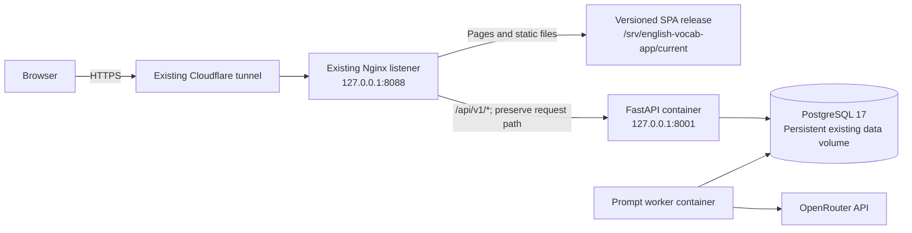

# Jetson deployment with the existing website

Target: `jjnano@192.168.0.108`. Existing public hostname:
`https://vocab.jerryitdev.com`. Keep the working Cloudflare hostname and tunnel.



Nginx serves the client; there is no Node web process on the board in this setup.
The API, database and prompt worker run on the Jetson. All browser API calls use
the website's own HTTPS origin, preserving refresh-cookie behavior. PostgreSQL
has no published host port, and the API is bound to host loopback only.

## Before running anything

SSH access was not available during preparation. The live Jetson OS, Docker
configuration, Nginx configuration, database location and public site have not
been changed or verified. Public requests from the preparation environment
received HTTP 403; that does not establish whether the site works in a browser.

The deployment scripts require a working ARM64 Docker Engine, Docker Compose v2
with `--wait`, Nginx, Python 3, curl, git and sudo. They do not install packages,
replace system Node, restart unrelated services, change DNS, or install or alter
Cloudflared. Run as `jjnano`, not root.

Use an up-to-date checkout on the board, including all backend application code
and migrations through `0015`. The paths below assume `~/english-vocab-app`;
substitute the location of the existing checkout rather than creating a second
deployment unknowingly.

Read-only inspection on the Jetson:

```bash
ssh jjnano@192.168.0.108
cd ~/english-vocab-app
uname -m
docker compose version
docker ps --format '{{.Names}}'
docker volume ls
readlink -f /srv/english-vocab-app/current
curl -fsS http://127.0.0.1:8001/health
curl -sS -o /dev/null -w '%{http_code}\n' http://127.0.0.1:8088/api/v1/auth/me
```

For an already-running stack, confirm its Compose project and actual database
mount before switching definitions. The normal project for `backend/` is
`backend`, with volume `backend_postgres_data`. If the existing project differs,
set `COMPOSE_PROJECT_NAME` to that existing name. For a custom named data volume,
set `POSTGRES_VOLUME_NAME` to its existing name in the private backend environment.
The deployer compares the running database mount with the selected volume and
stops on a mismatch. An existing bind-mounted database requires preserving that
mount explicitly in the production definition. Never remove data volumes to make
deployment proceed.

If an API is already listening but is not part of the selected Compose project,
the script stops. Identify its current manager and database first. Use
`--skip-backend` only when intentionally publishing the client against the
existing backend; it does not update that backend.

## Build the web client on the Pi or a laptop

Building off-board avoids installing a new Node runtime or consuming build memory
on the Nano. Expo SDK 58 supports `single`, `static` and `server` web output; this
Nginx setup uses `single` (a SPA). [Expo SDK 58 configuration](https://docs.expo.dev/versions/v58.0.0/config/app/#output).

The new `client/app.config.js` selects SPA output only when
`WORDRECALL_WEB_OUTPUT=single` is set. Other builds keep the `server` setting in
`app.json`, along with the existing iOS/Android configuration.

The client pins Jest's coverage dependency `test-exclude` to version 8 through
an npm override. This removes the deprecated `glob` 7/10 and `inflight` chains
and is compatible with the Node 24 build requirement. Remove the override once
both Jest and the React Native Jest preset use version 8 or newer themselves.

Two upstream development-tool warnings may still appear during `npm ci`:
`whatwg-encoding@3` comes from Jest's jsdom environment, and `eslint@9` remains
necessary while the React lint plugin's peer dependency excludes ESLint 10.
These warnings do not mean the SPA export failed. Revisit them when the upstream
packages support newer dependencies; do not bypass peer checks or substitute
incompatible major versions just to hide the warnings.

From the repository root on the build machine, with Node 24.3+:

```bash
cd client
npm ci
EXPO_NO_DOTENV=1 \
WORDRECALL_WEB_OUTPUT=single \
EXPO_PUBLIC_API_BASE_URL=https://vocab.jerryitdev.com \
EXPO_PUBLIC_WEB_API_BASE_URL=https://vocab.jerryitdev.com \
node node_modules/expo/bin/cli export --platform web --output-dir dist
cd ..
rsync -av client/dist/ jjnano@192.168.0.108:~/wordrecall-web/
```

`client/dist/index.html` must exist at the export root. A `dist/client` plus
`dist/server` export is not suitable for the static publisher. All
`EXPO_PUBLIC_*` values are public and become part of the JavaScript bundle.

For optional on-board builds, the deployer requires Node 24+ and runs `npm ci`
and the same SPA export with the selected domain. Official Node 24 ARM64 binaries
require glibc 2.28+ and a supported kernel; do not replace system libraries or an
existing application's Node installation to force this on an older Jetson.
[Node platform requirements](https://github.com/nodejs/node/blob/v24.x/BUILDING.md#platform-list).

## Transfer the deployment changes

If these changes have been committed, update the board's existing checkout with
the normal Git workflow. For these deployment files before committing, copy only
the reviewed files from the repository root:

```bash
rsync -avR \
  devops/deploy-jetson.sh \
  devops/publish_production_web.sh \
  devops/deploy_backend.sh \
  backend/docker-compose.jetson.yml \
  client/app.config.js \
  docs/DEPLOY_JETSON.md \
  jjnano@192.168.0.108:~/english-vocab-app/
```

This copies deployment files only, not the rest of the application. Ensure the
board's application code and migrations are current separately. Do not copy real
environment files, signing files or credentials into Git or the public web build.

## Backend configuration and existing data

Keep an existing `backend/.env` and its database credentials. For a genuinely new
installation only, create it privately from `backend/.env.example`, generate a
unique application secret, and configure the database password before starting.
Use `chmod 600 backend/.env`.

Relevant private configuration:

| Setting | Requirement |
| --- | --- |
| `SECRET_KEY` | Generated application secret; keep the current one for an existing deployment |
| `POSTGRES_USER`, `POSTGRES_DB`, `POSTGRES_PASSWORD` | Match the existing database; changing these variables does not rotate a populated database's credentials |
| `POSTGRES_PASSWORD_URLENCODED` | Optional percent-encoded password for the SQL connection URL when the existing password contains URL-reserved characters; keep the actual password in `POSTGRES_PASSWORD` |
| `COMPOSE_PROJECT_NAME` | Existing Compose project name if different from `backend` |
| `POSTGRES_VOLUME_NAME` | Existing named PostgreSQL volume if different from the project default |
| `MIGRATION_BACKUP_HOST_DIR` | Persistent backup directory; defaults to the user's `.local/state/english-vocab-app/migration-backups` |
| `OPENROUTER_URL`, `OPENROUTER_MODEL` | OpenRouter API base URL and text-generation model ID |
| `OPENROUTER_API_KEY` | Private OpenRouter API key for generation |
| `OLLAMA_URL`, `EMBEDDING_MODEL` | Reachable Ollama server and installed embedding model |
| `PROMPT_JOB_MAX_ATTEMPTS` | Defaults to 5 |

For a new database, generate URL-safe passwords and application secrets with
`python3 -c 'import secrets; print(secrets.token_urlsafe(48))'`, then save them only
in the private environment file. Do not change an existing database's password
without an explicit credential-rotation procedure.

The standalone `backend/docker-compose.jetson.yml` forces production mode,
secure refresh cookies, the exact public CORS origin, and pre-migration backups.
It removes development live reload and source mounts. Do not merge it with the
development Compose file: use the standalone definition selected by the deployer.

## Deploy both servers on the board

With the current checkout and the uploaded SPA on the Jetson:

```bash
cd ~/english-vocab-app
bash devops/deploy-jetson.sh --web-build-dir "$HOME/wordrecall-web"
```

Default update sequence:

1. Check the existing release link, Nginx syntax, selected Compose definition and
   database identity, without changing the website configuration.
2. Validate the prebuilt SPA, or build it if no upload directory was supplied.
3. Build API and worker images; a build failure leaves the running worker alone.
4. Start/check PostgreSQL, stop the old worker, and recreate the API.
5. Run guarded forward migrations with a production backup before serving.
6. Wait for the new API to respond, then recreate the worker.
7. Confirm backend health and a 401 from the unauthenticated Nginx API proxy.
8. Copy the SPA into a versioned release and atomically switch `current`.
9. Check the home page, a deep link, sign-in, and the API proxy locally. A local
   check failure restores the previous frontend link.
10. Check public HTML and the public API through the existing domain.

No DNS or tunnel reconfiguration is needed when the existing tunnel already
targets `http://localhost:8088`. If Cloudflare Access intentionally prevents
unauthenticated command-line checks, use `--skip-public-check` and verify the
site in an authorized browser. Local page and API checks still run.

## Nginx: preserve by default, configure only deliberately

An existing working Nginx listener is not rewritten by default. It must route
`/api/` to `http://127.0.0.1:8001` while preserving the full request path, and
serve the SPA with an `index.html` fallback for deep links. The backend's `/api/v1`
prefix must not be stripped by a trailing-slash `proxy_pass` rewrite.

If the old managed script created an SPA-only site, or this is a new site, inspect
the configuration first and explicitly request this app's managed configuration:

```bash
bash devops/deploy-jetson.sh \
  --web-build-dir "$HOME/wordrecall-web" \
  --configure-nginx
```

This touches only `/etc/nginx/sites-available/english-vocab-app.conf` and its
matching enabled-site symlink. It refuses to overwrite an unmarked configuration
or a link owned by another site, validates and reloads Nginx, and restores the
previous configuration if validation or reload fails. It binds only loopback
port 8088, preserving other listeners on 80/443 and other applications.

The managed listener trusts the Cloudflare connecting-IP header only from
loopback, replaces forwarded headers when proxying, and serves index HTML without
long-lived caching. The API accepts proxy headers inside the trusted private
Compose network; do not expose its container port directly to the Internet.
For an existing manually managed Nginx site, retain equivalent header handling.

## Publish only a new frontend

This keeps the backend containers, Nginx configuration, database and tunnel alone:

```bash
bash devops/publish_production_web.sh --build-dir "$HOME/wordrecall-web"
```

The publisher rejects server output, source-tree files, environment files and
symlinks in the export. Both backend health and the API proxy must pass before it
changes the frontend link. It retains prior release directories. If public checks
fail after local success, it reports the failure and keeps the locally verified
new release active; inspect Cloudflare Access/cache rather than rerunning database
migrations or changing DNS blindly.

The SPA directory supplied to either script must have been built for the selected
public domain. Rebuild with both public API variables if changing domains.

## Operations

From the Jetson repository root:

```bash
export BACKEND_COMPOSE_FILE="$PWD/backend/docker-compose.jetson.yml"
bash devops/deploy_backend.sh status
bash devops/deploy_backend.sh logs
bash devops/deploy_backend.sh queue-status
```

Keep that production file selected for updates too. The helper's default file is
the development stack; accidentally selecting it for production would restore
development settings. For custom domains, also export the same `PUBLIC_DOMAIN`.

Failed prompt jobs keep their safe fallback questions. To retry one after fixing
its provider issue:

```bash
docker compose --project-directory backend -f backend/docker-compose.jetson.yml \
  exec -T api python -m app.prompt_jobs retry --word-id WORD_UUID
```

Backend schema migrations are forward-only. Frontend link rollback does not
roll back schema changes. Existing database volumes and private backups are
retained; do not run volume deletion or database downgrade commands as recovery.
