# Backend architecture

This describes the backend source currently in this repository, including
migrations through `0015` and the deployment helper. It describes the local
Docker Compose setup; it does not claim that a running deployment has been updated.

## 1. Processes and external dependencies

The backend has one shared application codebase, an HTTP API process, and a
background worker process. Both processes use the same PostgreSQL database.
Queue administration and user export run as occasional commands.

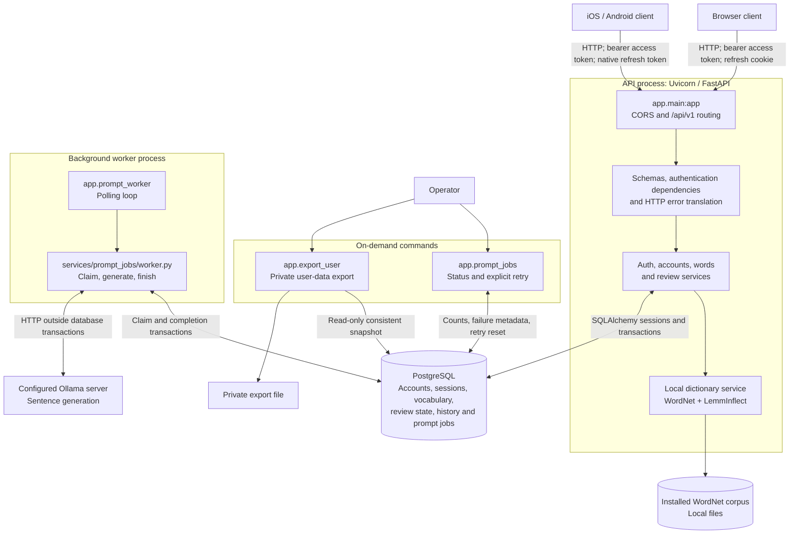

The API never calls Ollama while saving a word or serving a review. Local
dictionary search does not use a network service. The queue is a database table;
there is no separate message broker. The current worker processes one job at a
time, but multiple PostgreSQL workers can claim different jobs.

## 2. Code organization and dependency direction

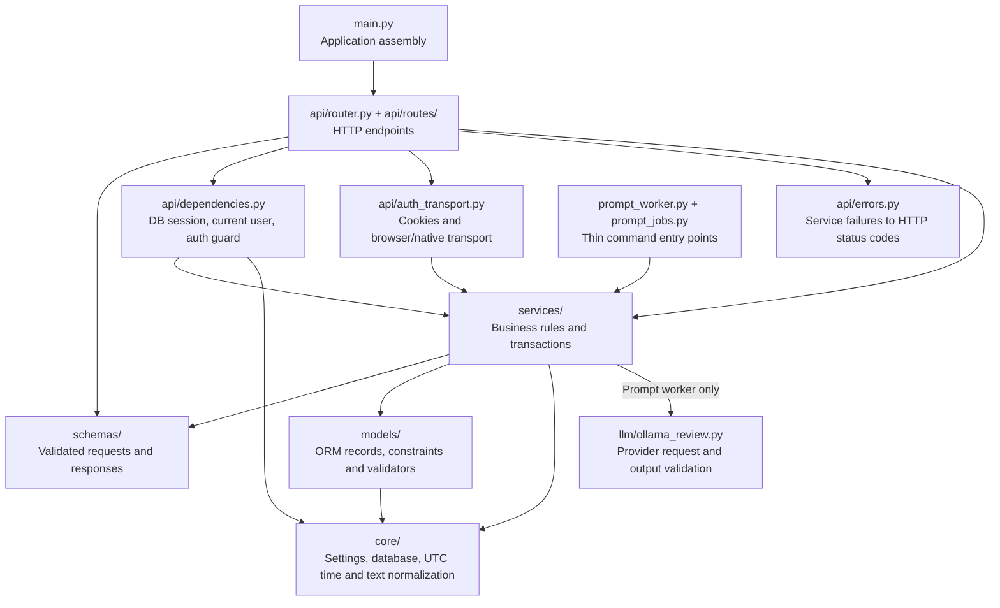

```text
backend/
  app/
    main.py
    api/
      router.py
      auth_transport.py
      dependencies.py
      errors.py
      routes/                  auth, account, words, reviews, health
    core/                      config, database, time, text
    schemas/                   auth, account, words, reviews
    models/                    user, auth, word, review_state,
                               review_attempt, prompt_job
    services/
      auth.py
      accounts.py
      words.py
      dictionary.py
      errors.py
      reviews/
        service.py             Session and answer orchestration
        selection.py           Shared word-selection query
        queries.py             Review queue queries and totals
        answers.py             Answer comparison
        scheduling.py          SM-2 scheduling
        prompts.py             Fallback construction and answer masking
        choices.py             Four-option distractor selection
        tickets.py             Signed review authorization
      prompt_jobs/
        worker.py              Claiming, generation and completion
        management.py          Queue inspection and failed-job reset
    llm/ollama_review.py
    prompt_worker.py            Continuous worker command
    prompt_jobs.py              Status/retry command
    migrate.py                  Guarded forward-only migration command
    migration_backup.py         Pre-migration database backups
    export_user.py              Operator-only data export
  migrations/versions/          Immutable shipped schema revisions
  tests/
    api/                       Accounts, contracts, words, answers,
                               sessions and prompt-worker integration tests
    test_*.py                  Focused service/model/command tests
  docker-compose.yml
  Dockerfile
  entrypoint.sh
```

## 3. HTTP request boundaries

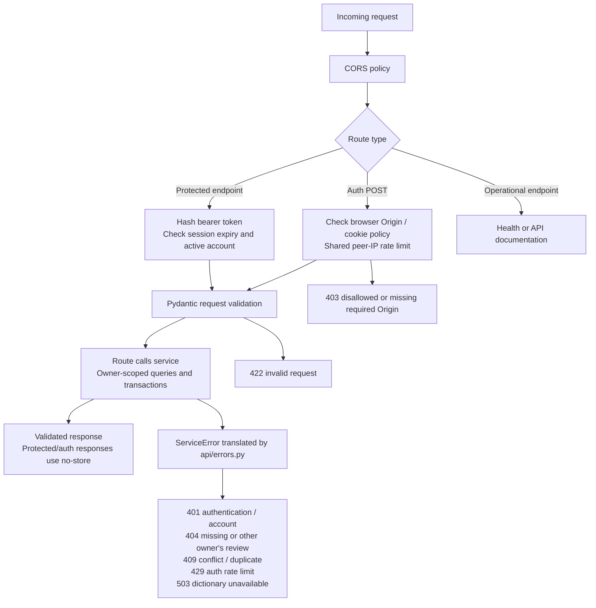

The two authentication branches differ: Origin checks and the database-backed
rate limit protect auth POST routes; bearer authentication protects product
routes and `/auth/me`. `/health` checks process liveness without querying the
database. Body validation and dependencies are shown as conceptual stages, not
a guarantee about every internal framework execution step.

| Method | Route | Responsibility |
| --- | --- | --- |
| POST | `/api/v1/auth/register` | Create account and initial session; optional validated timezone |
| POST | `/api/v1/auth/sign-in` | Verify password and issue a new session |
| POST | `/api/v1/auth/refresh` | Lock session and rotate tokens |
| POST | `/api/v1/auth/logout` | Delete the authenticated refresh session |
| GET | `/api/v1/auth/me` | Return the active account profile |
| PATCH | `/api/v1/account` | Update the current account's validated timezone |
| DELETE | `/api/v1/account` | Atomically erase account and owned records |
| GET | `/api/v1/words/search` | Local lexical search with owner-specific saved markers |
| POST | `/api/v1/words` | Save word, fallback prompt, review state and generation job |
| GET | `/api/v1/reviews/next` | Return immediately due hints; limit 1–50 |
| GET | `/api/v1/reviews/summary` | Saved-word and user-local daily due totals |
| GET | `/api/v1/reviews/preparation` | Matching count and bounded session count |
| GET | `/api/v1/reviews/session` | Up to 50 masked review items and signed tickets |
| POST | `/api/v1/reviews/{word_id}/choices` | Reveal four options for an authorized review item |
| POST | `/api/v1/reviews/{word_id}/answer` | Grade, record history and update scheduling atomically |
| GET | `/health` | Process liveness |
| GET | `/docs`, `/openapi.json` | API documentation and schema |

## 4. Authentication and refresh rotation

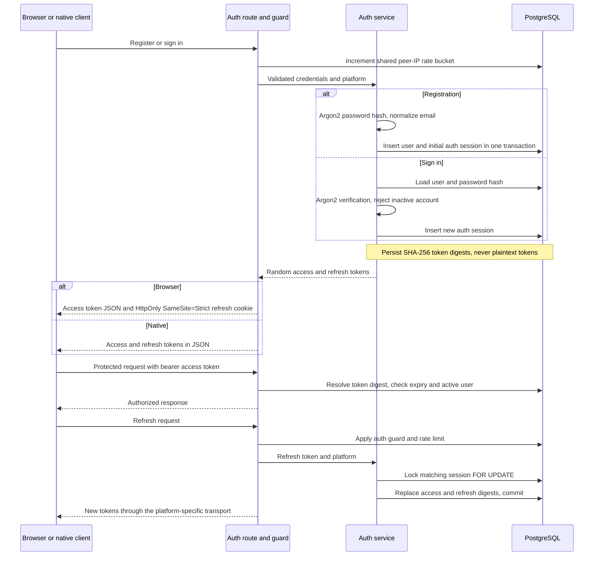

Defaults are a 15-minute access token, a 30-day refresh lifetime, and 20 auth
POST requests per peer IP per 60-second window. Refresh rotation preserves the
session's original refresh expiry. Browser cookie security is configurable;
native token transport requires `X-Auth-Platform: native` and no Origin header.
Auth failures and disabled/deleted accounts do not bypass the guard.

## 5. Word search and atomic save

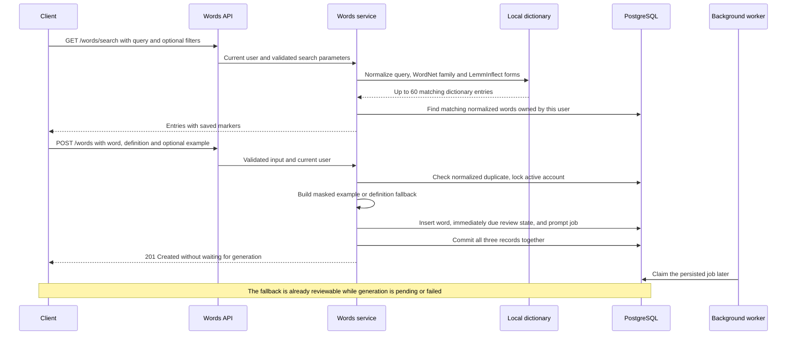

The unique `(user_id, normalised_word)` constraint resolves concurrent duplicate
saves. A failed enqueue rolls back the word and review state as well. Dictionary
corpus access is protected by a process-local lock and bounded caches because
the lexical reader is shared by request handlers.

## 6. Review selection, masking and choices

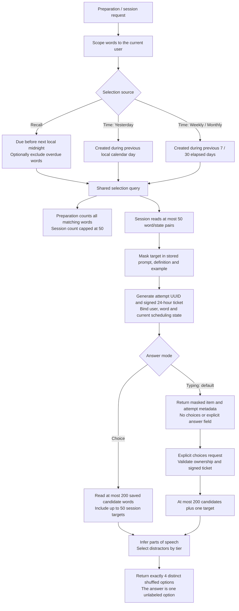

The candidate query follows the existing `(user_id, normalised_word)` index.
Profiles cover at most 250 saved words per choice session or 201 per single-item
choice request; lexical fallback processing is also bounded. Distractor tiers
prefer saved words with matching parts of speech, lexical family words, other
saved candidates, matching general vocabulary, then general vocabulary of any
part of speech.

Recall selection includes all reviews scheduled before the end of the user's
local day, including items not due at this instant. `/reviews/next` instead uses
`due_at <= now`. Signed session tickets authorize the selected snapshot, including
time-based practice of words whose normal due date is in the future. Updating a
timezone changes local selection boundaries without rewriting UTC due dates.

## 7. Answer submission, concurrency and retries

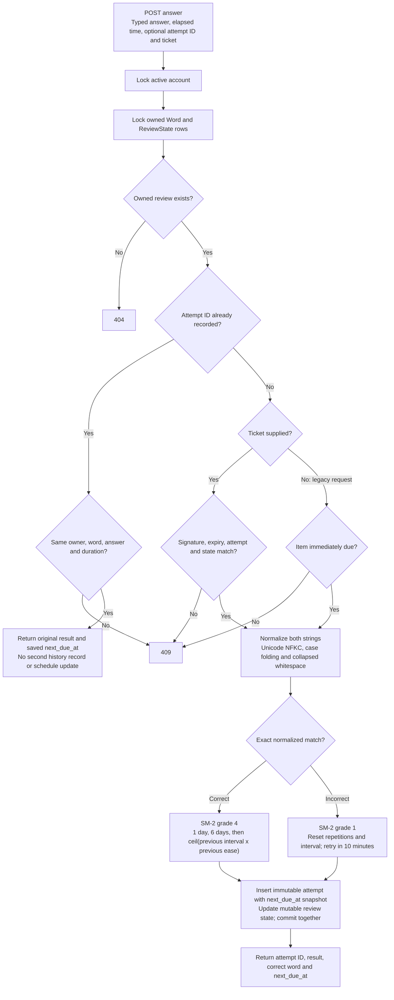

Duplicate attempts are checked before ticket expiry, so a lost-response retry
can still return an accepted result after its original ticket expires. Attempts
created before migration `0014` have no original due-date snapshot and retain
the legacy fallback to the current schedule. Accents, punctuation and spelling
remain significant after normalization. There is no daily attempt cap.

The account lock serializes answer writes, word creation, timezone changes and
account erasure for that account. Password-session rotation separately holds the
auth-session row lock through commit. Database constraints and history triggers
provide protections in addition to service-level checks.

## 8. Durable prompt-job lifecycle

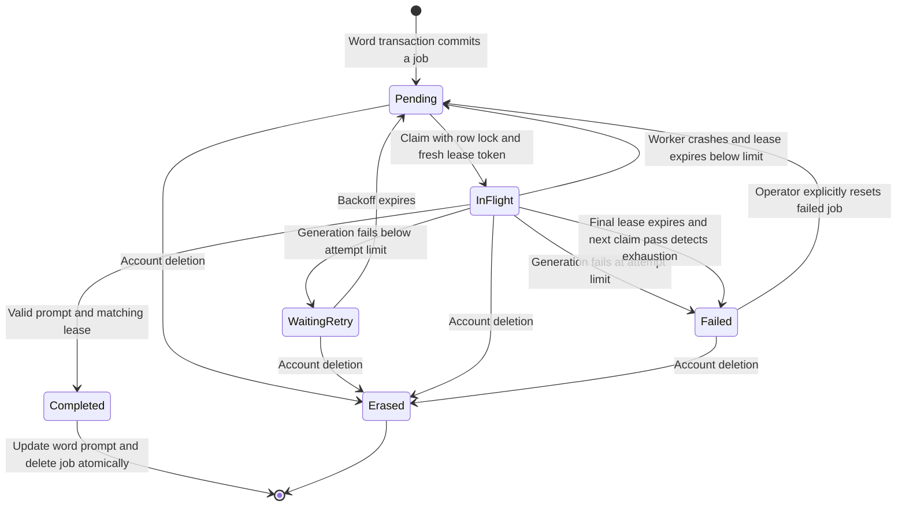

These are derived states, not values in a status column. The worker uses
`available_at`, `lease_token`, `attempts` and `failed_at` to determine eligibility.
Queue monitoring reports an expired lease as pending until the next claim pass
reclaims it or marks it failed.

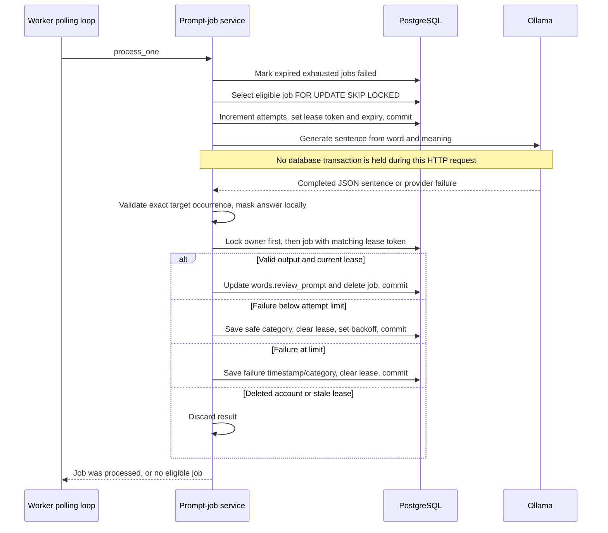

Default automatic limit: five claims. Retry delay is
`min(3600, 5 * 2 ** min(attempts, 10))` seconds, starting at ten seconds.
Lease duration is `OLLAMA_TIMEOUT_SECONDS + 60` seconds. The loop sleeps one
second when idle and five seconds after a database error. Lease expiry permits
recovery; it does not prove a slow or stalled old worker has stopped, so stale
completion protection is essential.

Failed jobs remain stored and keep the word's fallback usable. A partial index
on `(available_at, word_id) WHERE failed_at IS NULL` excludes terminal failures
from the ready queue. Safe categories distinguish provider HTTP errors,
connection errors, invalid input/output, and exhausted attempts. Vocabulary and
provider response bodies are not written to worker failure logs or queue status.

## 9. Database relationships

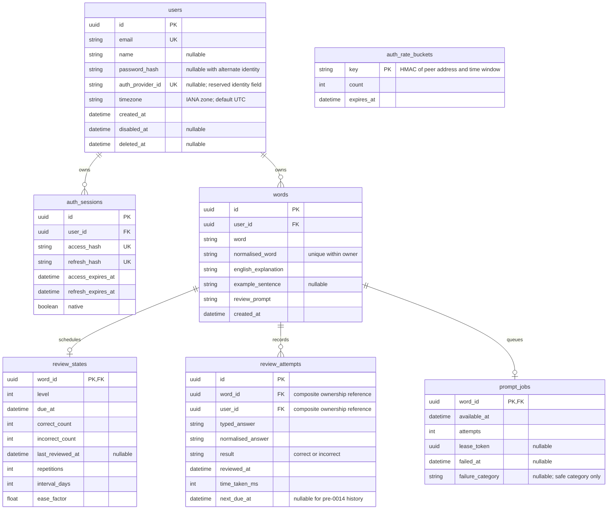

`review_attempts.(word_id, user_id)` references `words.(id, user_id)` as one
composite foreign key, preventing cross-account history references. Rate buckets
are shared operational records without a user foreign key. Word creation inserts
one review-state row, but the schema permits a word without one; the optional
ER relationships reflect database constraints rather than only the normal flow.
Completed prompt jobs are removed, while terminal failures remain until retry
or account erasure. The identity field does not imply an implemented OAuth flow.

## 10. Account erasure and timezone changes

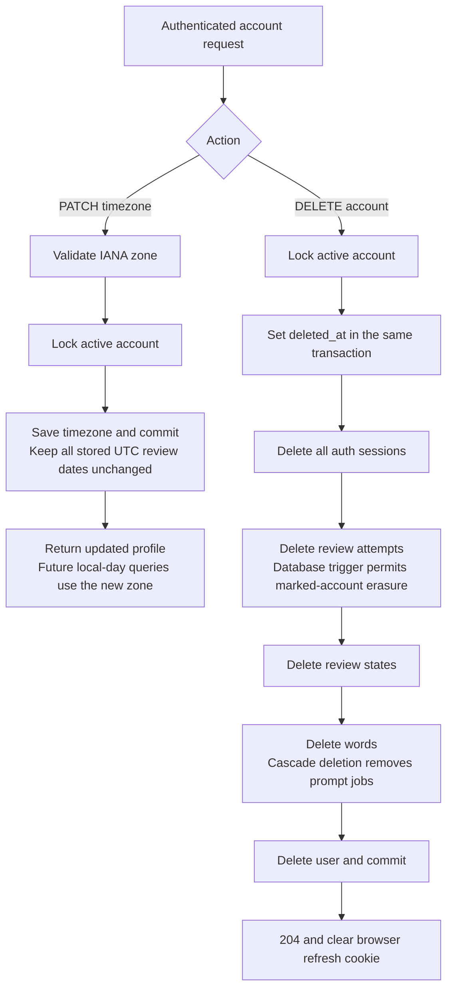

Ordinary history updates and deletes remain blocked. A worker finishing during
erasure uses the same owner-first locking order and rechecks existence, so a late
generation result cannot recreate erased words. Application erasure does not
rewrite retained infrastructure logs or backups.

## 11. Deployment and migration order

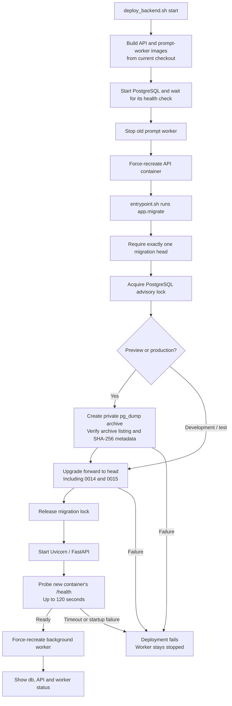

The current Compose file is for development: API port `8001` maps to container
port `8000` by default, Uvicorn uses live reload, application sources are mounted,
and PostgreSQL's host port is bound to loopback. Database data and migration
backups persist outside the application containers. The worker uses the same
application build context and environment but bypasses the API migration
entrypoint. Starting Compose directly has weaker ordering: the worker can start
when the API container is merely running, then retries database errors while
migrations finish. The helper waits for the recreated API to serve first.

Migration files that have shipped are immutable. Schema fixes add new revisions;
deployment never downgrades or stamps a database. A health check on an older
already-running API is only liveness and does not establish migration currency.

## 12. Operations and verification

| Operation | Command from repository root |
| --- | --- |
| Build and start current backend | `./devops/deploy_backend.sh start` |
| Show containers | `./devops/deploy_backend.sh status` |
| Follow API and worker logs | `./devops/deploy_backend.sh logs` |
| Inspect queue counts and failed job IDs | `./devops/deploy_backend.sh queue-status` |

From `backend/`, reset a failed job only after correcting its cause:

```bash
docker compose exec -T api python -m app.prompt_jobs retry --word-id WORD_UUID
```

Status reports pending, in-flight, waiting-retry and failed counts, the oldest
pending timestamp, and at most 20 failed-job identifiers with safe metadata.
Retry resets only terminal failures, clearing their failure/lease fields and
attempt count. It cannot reset a pending or in-flight job.

Backend verification includes Ruff, mypy, pytest, temporary SQLite databases,
and CI API integration tests against isolated PostgreSQL schemas. PostgreSQL
tests exercise row-lock behavior that SQLite cannot reproduce. Deployment-helper
tests simulate Docker to check service ordering and failure handling without
restarting a live stack.

Source entry points: [application](../backend/app/main.py),
[API routes](../backend/app/api/routes/), [services](../backend/app/services/),
[database models](../backend/app/models/),
[Compose setup](../backend/docker-compose.yml), and
[deployment helper](../devops/deploy_backend.sh).
