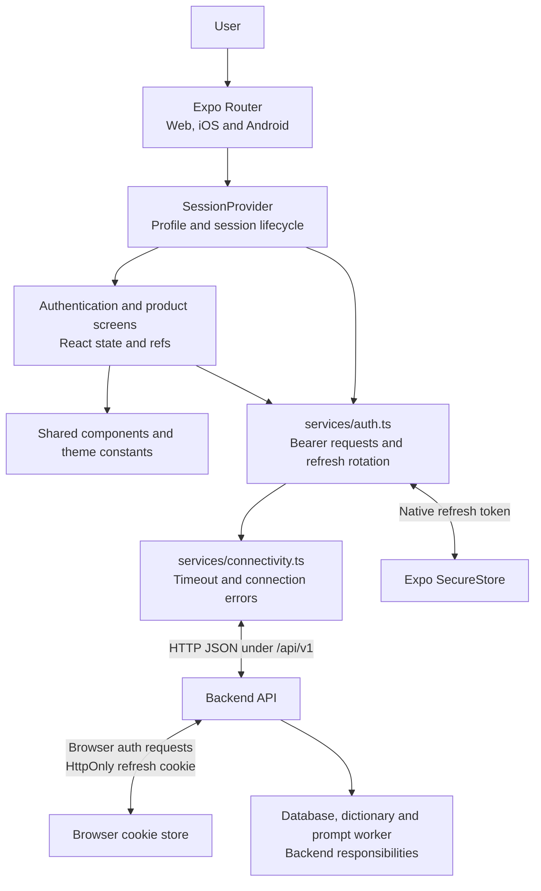
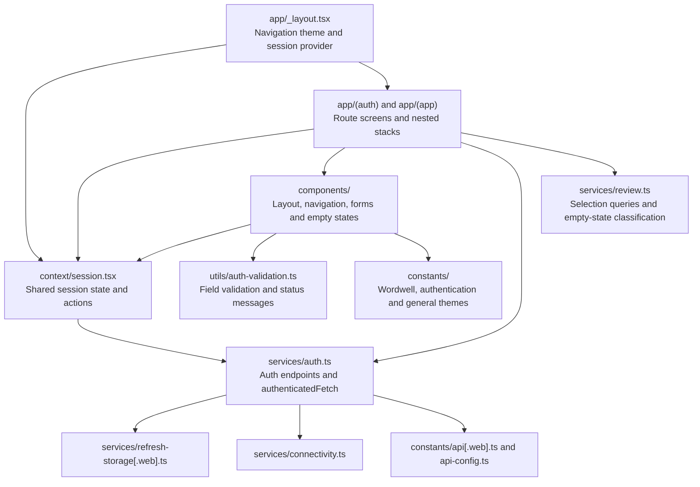
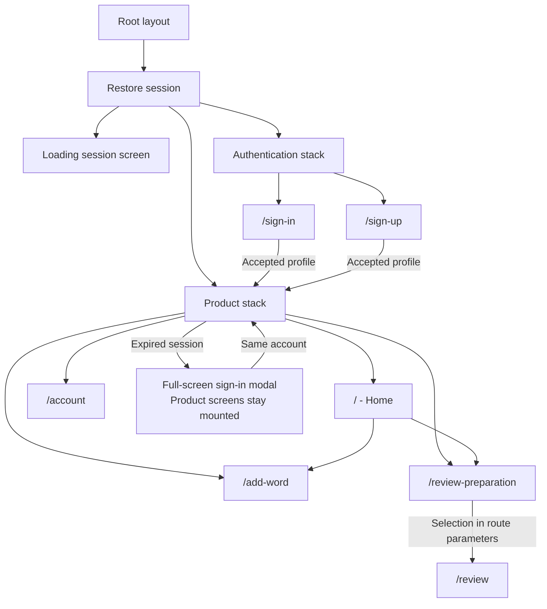
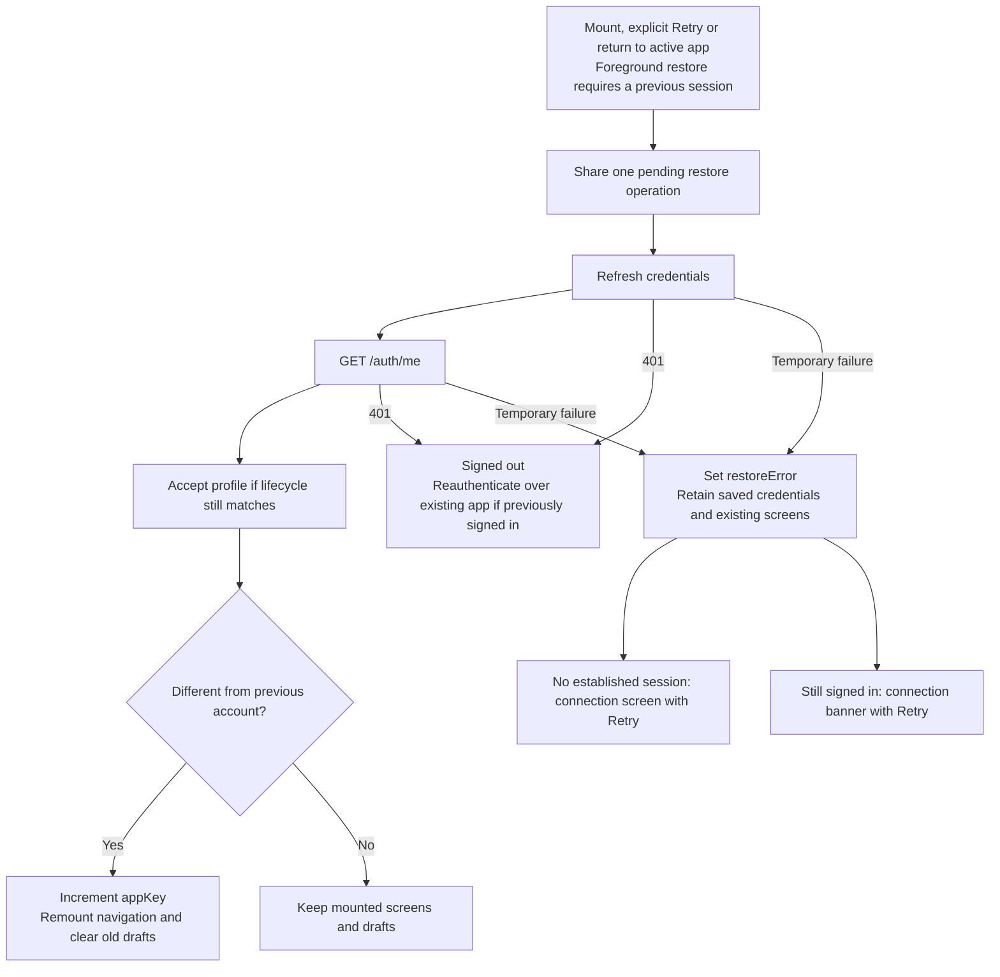
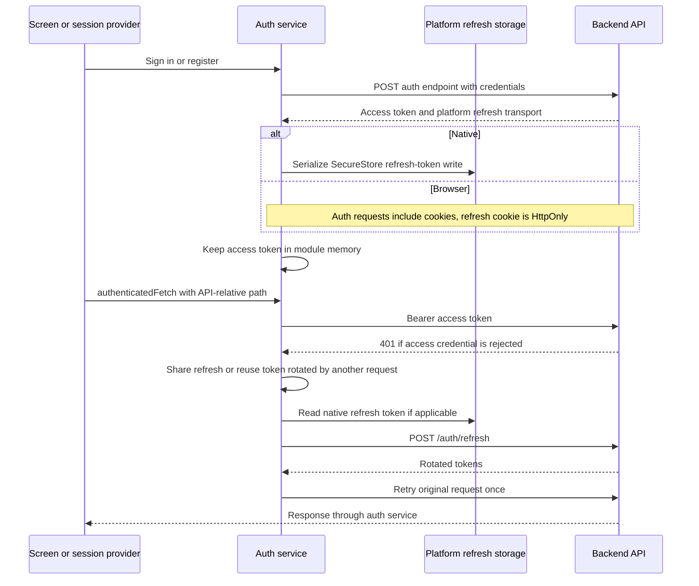
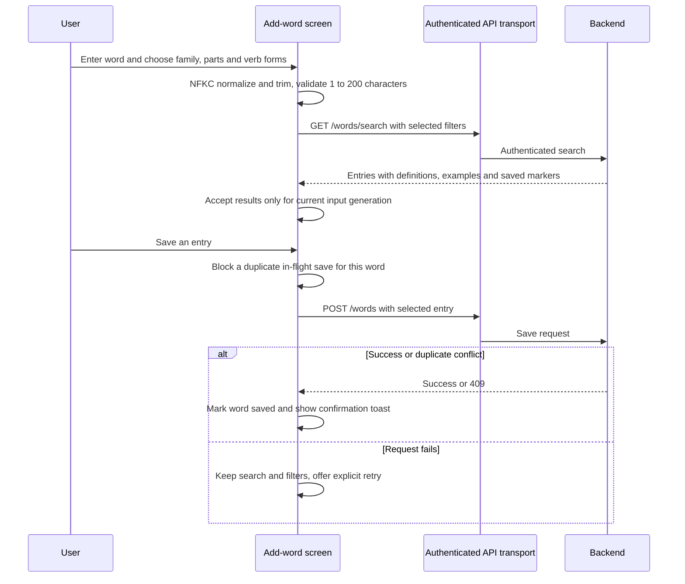
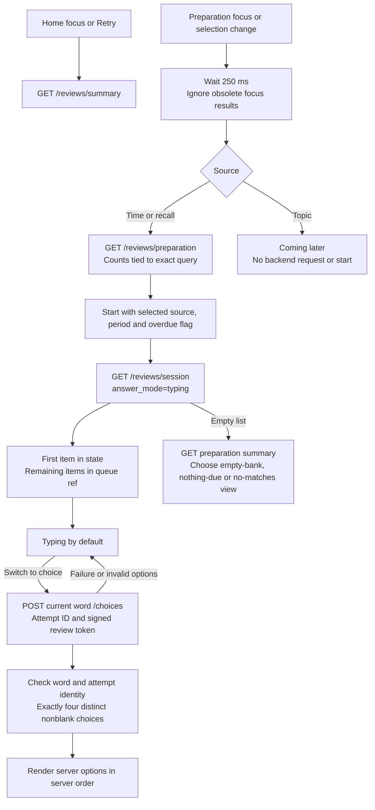
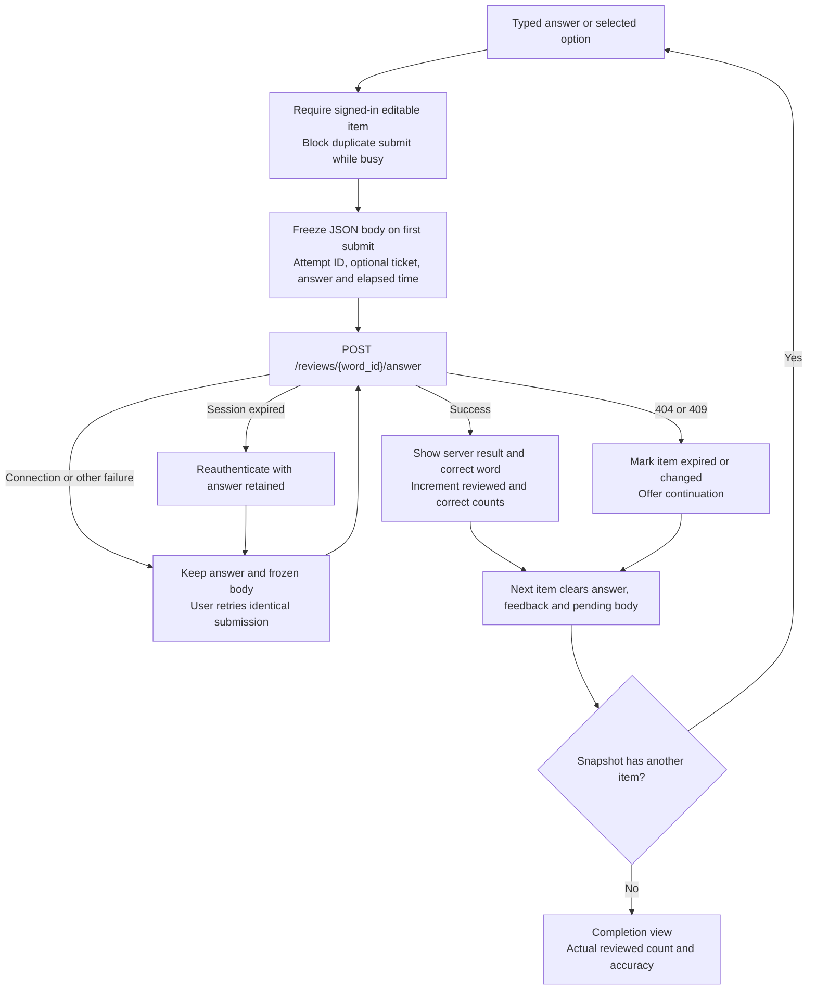
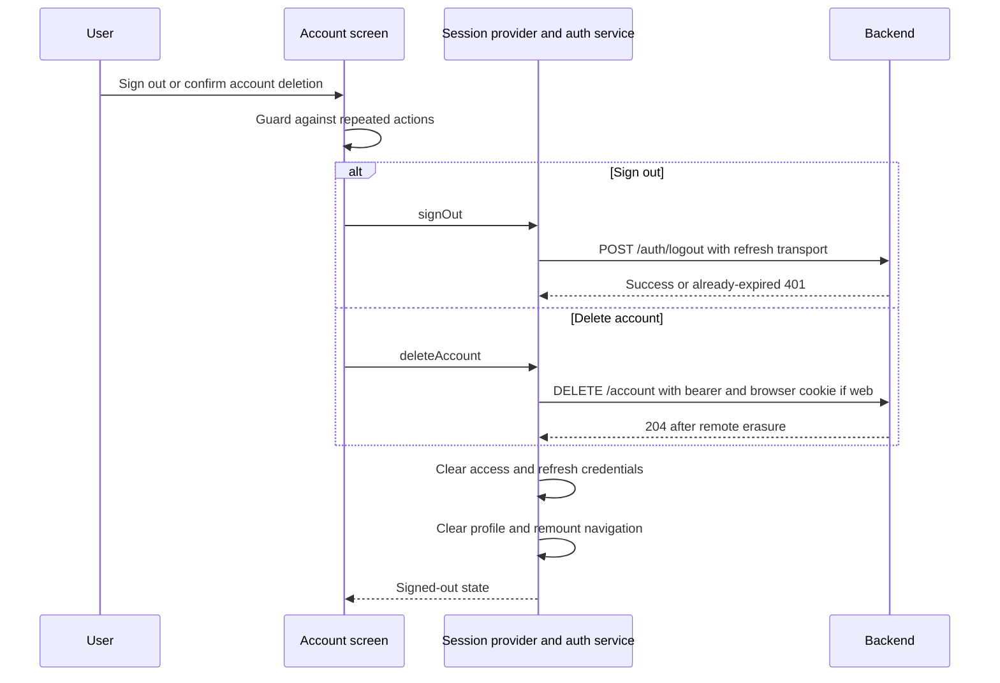
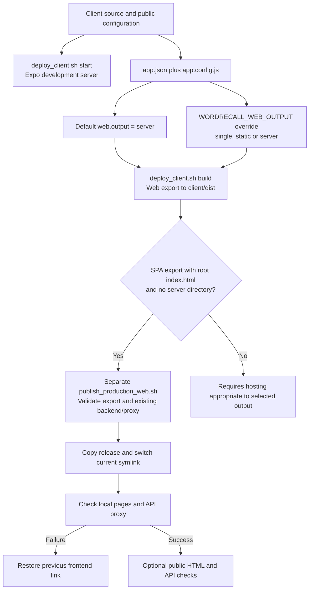

# Client architecture

This describes the client source currently in this repository. It complements
[backend architecture](backend-architecture.md) and describes implemented behavior,
including the web export helpers. It does not establish the state of a running
deployment or a published native app.

## 1. Runtime and external dependencies

WordRecall is an Expo SDK 58 application using React 19.3, React Native 0.88.1,
React Native Web and Expo Router. The product screens display Wordwell branding.
Web, iOS and Android share screen logic, with platform-specific modules for
credentials, API configuration and form controls.



The client does not access PostgreSQL, WordNet or Ollama directly. Product data
requires a server response. There is no client database, durable review cache,
offline write queue or background synchronization service in the current source.

## 2. Code organization and dependency direction



```text
client/
  app.json                     Native identity, plugins and default web output
  app.config.js                Optional web-output override
  src/
    app/
      _layout.tsx              Session restoration and protected navigation
      (auth)/                  Entry redirect, sign-in, sign-up and stack
      (app)/
        _layout.tsx            Product stack
        index.tsx              Home summary
        add-word.tsx           Dictionary search and word save
        review-preparation.tsx Selection and live counts
        review.tsx             Session queue, answers and feedback
        account.tsx            Profile, sign-out and deletion confirmation
    context/session.tsx        Session context and lifecycle protection
    services/
      auth.ts                  Tokens, auth calls and one auth retry
      refresh-storage.ts       Native SecureStore adapter
      refresh-storage.web.ts   Browser cookie transport marker
      connectivity.ts          Bounded fetch and connection messages
      review.ts                Review query and summary helpers
    components/                Shared UI and web-specific form adapters
    constants/                 API configuration and theme values
    hooks/                     Color-scheme and theme helpers
    utils/auth-validation.ts   Form validation and authentication messages
  assets/                      Icons, splash image and product illustrations
  tests/
    *.test.mjs                 Service, configuration and screen behavior tests
    components/flows.test.tsx  Rendered search and review flow tests
```

Screens call `authenticatedFetch` directly and own their response types, loading
states and errors. There is no separate product API repository layer or global
query cache. `SessionProvider` holds shared identity state; product drafts and
review progress live in mounted screen state.

## 3. Navigation and screen boundaries



The product navigator is a stack. `AppScreen` supplies a shared header and bottom
navigation links for Home, Add, Review and Account; these are not a separate tab
navigator. The Review link opens preparation rather than a new review directly.

The root keeps the product stack when signed in or when an established session
needs reauthentication. It also preserves an initial direct link to `/add-word`,
`/review` or `/account` while presenting sign-in. That explicit direct-link list
does not include `/review-preparation`. Backend authorization still applies to
every protected request.

## 4. Session restoration and draft lifetime



`profile`, `signedIn`, `loading`, `needsSignIn`, `restoreError` and `appKey` are
context state. Mounted checks and lifecycle versions prevent obsolete operations
from accepting an old profile. Explicit sign-out and successful account deletion
clear context and change `appKey`. A reload or process termination also loses
in-memory drafts and review progress.

## 5. Authentication and token transport



Access tokens are never persisted. Native auth sends `X-Auth-Platform: native`,
omits cookies, and stores the refresh token under `wordrecall.refresh` using
`WHEN_UNLOCKED_THIS_DEVICE_ONLY`. The web storage adapter reads no token and
writes nothing; browser refresh credentials belong to the backend cookie.

`authenticatedFetch` rejects absolute and protocol-relative paths. It ensures an
access token exists, attaches a bearer header, and retries once after a 401.
Concurrent refresh callers share a promise. A late 401 can reuse a token another
request already rotated. Session versions reject results belonging to an older
sign-in or sign-out, while serialized storage operations order credential writes.

A refresh 401, or a retried 401 for the still-current token, expires the local
session and notifies the provider. Temporary connection failures retain refresh
credentials. Ordinary browser product requests omit cookies by default; account
deletion explicitly includes them so the response can expire the refresh cookie.

## 6. Word search and save



Search is explicitly submitted. Base form `V1` is always requested; `V2` and `V3`
are optional. Editing query or filters increments a generation counter and clears
displayed results, preventing a stale search from replacing current results.
Search has one pending-operation guard; saves are guarded per word, allowing
different entries to save independently. A saved marker changes after a server
response, with 409 treated as already saved. Prompt generation stays on the
backend and does not block the client save workflow.

## 7. Review preparation and session snapshot



Preparation defaults to time, Weekly and inclusion of overdue words. The shared
query helper defaults an unspecified source to recall, so a direct `/review`
without selection parameters differs from opening preparation. Counts are hidden
when their query no longer matches. Topic is a visible placeholder.

The backend supplies a bounded snapshot of up to 50 items. The client advances
through that snapshot without fetching a new session for each answer. Choice mode
fetches options for the current item only; moving to another item in choice mode
loads that item's options. Returning to typing removes local choices. The client
does not construct distractors or perform scheduling and grading.

## 8. Answer submission, feedback and retry



Elapsed time uses `performance.now()` and is rounded and clamped to a nonnegative
32-bit signed integer. A retry reuses the original serialized body, including
duration, rather than making a new attempt. Backend attempt identity makes a
lost-response retry safe. This retained body is memory-only and requires an
explicit retry after a connection failure; it is not a durable submission queue.

Next advances the local snapshot. Skipping a conflicting item does not increment
the reviewed count, so completion can report that only part of the snapshot was
reviewed. Feedback and completion use accessible announcements; typing regains
focus when the item becomes editable after sign-in or a failed operation.

## 9. Account actions and failure handling



Account displays the accepted profile and provides a deletion confirmation modal.
It currently has no timezone editor even though the profile includes a timezone
and the backend supports updates. Failed logout or deletion remains retryable.
After a confirmed remote deletion, `AccountDeletedError` still clears provider
state if local credential cleanup fails.

`reachableFetch` bounds each request to 15 seconds and maps network failures,
timeouts and HTTP 502/503/504 to a shared connectivity message. Caller aborts are
propagated. Other HTTP statuses remain available to the calling screen or auth
service. The connectivity layer does not retry requests; authentication recovery
is the separate one-retry mechanism described above.

## 10. Platform UI and API configuration

| Concern | Shared behavior | Platform-specific implementation |
| --- | --- | --- |
| Authentication forms | Validation, pending guard, errors and focus | Web HTML form, labels, inputs and submit control; native adapters |
| Word search form | Same screen state and search function | Web Enter handling suppresses repeats and input composition |
| Refresh credential | Rotated by backend | Native SecureStore; browser HttpOnly cookie |
| API origin | Validated HTTP(S) base without embedded credentials, query or fragment | Web override and local-development hostname adjustment |
| Navigation | Expo Router links and stack screens | Selected web links expose `aria-current` |
| Screen layout | Shared header, scroll area and bottom links | Safe areas and iOS keyboard avoidance |

Native uses `EXPO_PUBLIC_API_BASE_URL`. Web prefers
`EXPO_PUBLIC_WEB_API_BASE_URL`, falling back to the shared value. During
non-production HTTP development, a configured loopback API hostname follows the
page hostname when the page uses loopback or a private IPv4 address. The configured
port and path remain intact. Production URLs are not rewritten.

These public values are embedded in the client build. Use the sanitized
[environment example](../client/.env.example) for local setup, keep real
environment files untracked, and rebuild exports after configuration changes.

The root provides a light/dark navigation theme. Product and authentication
components also use their own theme constants; this should not be interpreted as
proof that every screen fully adapts to dark mode.

## 11. Build and hosting boundaries



`deploy_client.sh build` exports web assets; it does not publish a site or create
native binaries. The separate production publisher requires `single` output and
an existing Nginx/API setup. Local post-switch failures restore the previous
frontend; public-check failures after local success leave the new local release
active. This diagram describes the scripts, not an executed deployment.

## 12. Operations and verification

| Operation | Command |
| --- | --- |
| Start development client from repository root | `./devops/deploy_client.sh start` |
| Export default web output from repository root | `./devops/deploy_client.sh build` |
| Run client checks from repository root | `./devops/deploy_client.sh check` |
| Type-check from `client/` | `npm run typecheck` |
| Lint from `client/` | `npm run lint` |
| Service and screen behavior tests from `client/` | `npm run test:unit` |
| Rendered component flows from `client/` | `npm run test:components` |

CI uses Node 24, installs from the npm lockfile, and runs lint, type-checking and
both test suites. Tests cover token transport and rotation races, connection
failures, form validation, stale search/count responses, duplicate saves, review
snapshots, exact answer retries, choices and empty states. These tests include
mocked requests and component environments; they do not establish device or live
deployment behavior.

Source entry points: [root layout](../client/src/app/_layout.tsx),
[product screens](../client/src/app/(app)/),
[session provider](../client/src/context/session.tsx),
[auth service](../client/src/services/auth.ts),
[shared components](../client/src/components/),
[client helper](../devops/deploy_client.sh),
[web publisher](../devops/publish_production_web.sh), and
[CI checks](../.github/workflows/client.yml).
